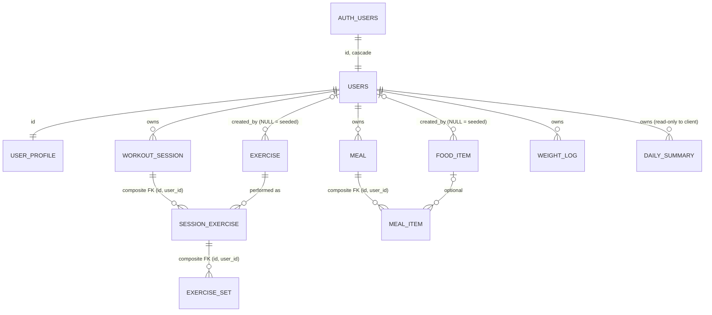

# feat: Database foundation with rigorous RLS testing (Phase 2)

## Summary

Build the full Postgres schema in local Supabase: every table with row-level security (RLS), CHECK constraints and indexes, a seeded exercise library, and generated TypeScript types. Prove it with a pgTAP suite (cross-user, signed-out, constraint and schema-wide guard tests) that runs in CI on every PR.

---

## Problem Frame

Every later phase (auth, weight, workouts, meals, summaries) reads and writes this schema, and every friend's data sits in it. A missing policy or a wrong grant leaks one person's data to another, and a bad column is expensive to fix once real data exists. Phase 2 therefore front-loads correctness: policies are written with the tables, and the tests are the definition of done, not an afterthought.

---

## Requirements

**Schema**
- R1. All tables from `docs/data-model.md` exist, except the `auth_identity` family (see KTD1), created only by new migration files.
- R2. Units and types follow CLAUDE.md: kg, cm, kcal, grams, `timestamptz` in UTC.
- R3. CHECK constraints reject negative weights (exercise sets may be 0 for bodyweight), non-positive body weights, reps and portions, negative per-100g values, and invalid enum values. Foreign keys, uniqueness (`weight_log`, `daily_summary`) and `ON DELETE CASCADE` from the auth user are in place.
- R4. Indexes exist on every column RLS policies or common queries filter by (`user_id`, date columns, parent keys).

**Security**
- R5. RLS is enabled with policies on every table, in the migration that creates it. `anon` has no table privileges. `authenticated` is granted only the operations that table allows.
- R6. A user can never read, insert, update or delete another user's rows, directly or through child tables, and can never reassign a row's owner.
- R7. Seeded reference rows cannot be altered by any client. Custom rows are private to their creator.
- R8. `daily_summary` is read-only to clients. Meal-level totals are derived by the database and cannot be written by clients (item-level values stay user-editable).
- R9. No SECURITY DEFINER function exists without a pinned `search_path`.

**Data and tooling**
- R10. About 100 common exercises with muscle group and equipment are seeded, reach every environment through a migration, and are idempotent.
- R11. `app/src/lib/database.types.ts` is generated from the schema, and CI fails if it drifts.
- R12. `supabase db reset` applies everything cleanly from scratch.

**Testing**
- R13. Every table and operation (select, insert, update, delete) is tested as user A, user B and signed-out, including child-table chains.
- R14. Every constraint is shown to reject bad data and accept valid data.
- R15. Schema-wide guard tests fail if any public table lacks RLS or a policy, or if `anon` holds a table privilege.
- R16. Deleting an auth user removes all of their rows.
- R17. CI runs the full suite plus the type-drift check on every PR.

---

## Scope Boundaries

- No Supabase client, auth configuration, sign-up trigger, or app screens (Phase 3 onward).
- No daily-summary generator or `pg_cron` job (Phase 9). Phase 2 only creates the table and its read-only policy.
- No Storage bucket or photo policies (Phase 8). `meal.photo_url` is just a nullable column.
- No Edge Functions, including delete-my-account (Phase 11). Phase 2 proves the cascade it will rely on.
- Phone OTP, friend sharing and notifications stay deferred (CLAUDE.md "not yet designed").

### Deferred to Follow-Up Work

- Keeping CHECK enum values and app Zod enums in sync (generated types show them as plain strings): decide the single-source approach in Phase 4 when the first enums reach the UI.
- Friend lookup by email needs a deliberate exposure mechanism, since `users` holds no contact data (before friend sharing).
- Whether meal totals should count only confirmed meals: decide in Phase 7 with the confirm flow.
- Writing `food_item` rows from the USDA / Open Food Facts function: Phase 7. Until then clients can create only their own custom foods.
- Storage-object deletion on account removal: Phase 11.
- Moving off the legacy `anon` / `service_role` key names: Phase 3 uses the new publishable key.

---

## Key Technical Decisions

- **KTD1. Identity builds on Supabase Auth.** `users.id` equals `auth.users.id` with `ON DELETE CASCADE`; `user_profile` is 1-1 with it. `auth_identity`, `google_identity` and `phone_identity` are dropped: Supabase already stores providers and verifies OTPs, and keeping an OTP hash column in our schema would be a liability. `docs/data-model.md` and CLAUDE.md are updated to match. (Confirmed with user.)
- **KTD2. `user_id` is copied onto child tables.** `session_exercise`, `exercise_set` and `meal_item` each carry `user_id`, tied to the parent by a composite foreign key so a child can never point at another user's parent. Policies become one cheap comparison on an indexed column. (Chosen by user; deviates from the drawn EERD, which docs will record.)
- **KTD3. One policy per operation, `TO authenticated`, written as `(select auth.uid())`.** Separate select/insert/update/delete policies make tests precise and let tables omit operations they should not allow. `WITH CHECK` on insert and update.
- **KTD4. Grants are explicit.** Supabase grants new tables to `anon` and `authenticated` by default, Each migration therefore revokes all privileges from both roles on the table (and on any view or function it creates), then grants `authenticated` only the operations that object allows. The U7 guard compares actual grants to an explicit allowed set per table. Default privileges for `anon` in `public` are revoked too. RLS is a second layer, not the only one.
- **KTD12. Reference rows must be visible to the referencing user.** The foreign-key check bypasses RLS, so `session_exercise.exercise_id` and `meal_item.food_item_id` are additionally constrained on insert and update to rows that are seeded or created by the same user. `session_exercise.exercise_id` uses NO ACTION and `meal_item.food_item_id` uses SET NULL (the item keeps its own copied macros); cascades flow only from the owner's `user_id`. No cross-user reference can exist, so deleting one user never reaches another's data.
- **KTD13. Client-asserted fields.** `source`, `user_confirmed` and `meal.status` are set by the client and are not authoritative; the confirm step is a UX control, not a security boundary. Calorie, macro and target columns get sane upper-bound CHECKs, and free-text columns get length limits so one account cannot exhaust the free storage tier. `meal.photo_url` must be NULL or start with the owner's id as a folder prefix.
- **KTD5. Owner cannot change.** A shared `BEFORE UPDATE` trigger (in a non-exposed schema) rejects any change to `id` or `user_id`. Column-level `UPDATE` grants are not used: they would break PostgREST upserts, which include every column in the payload, and the Phase 10 offline sync depends on upserts. An upsert that leaves the owner unchanged passes the trigger. `user_id` defaults to the caller, so clients need not send it.
- **KTD6. Reference tables use `created_by`.** `exercise` and `food_item`: rows with `created_by IS NULL` are seeded and read-only; all authenticated users can read them plus their own custom rows; clients write only their own.
- **KTD7. Meal totals are derived, not stored.** A view with `security_invoker` sums `meal_item`. The stored `total_*` columns in the data model are dropped, so they cannot drift or be forged. `daily_summary` still snapshots totals at write time (Phase 9).
- **KTD8. Enums are CHECK constraints, not Postgres enum types** (as the TODO says), so adding a value is a small migration. Proposed values: `gender` male | female | other; `activity_level` sedentary | light | moderate | active | very_active; `fitness_goal` lose_fat | maintain | build_muscle; `meal_type` breakfast | lunch | dinner | snack; `meal.status` draft | confirmed; `meal_item.source` ai | user; `food_item.source` usda | open_food_facts | user; `exercise.muscle_group` chest | back | shoulders | biceps | triceps | legs | glutes | core | cardio | full_body.
- **KTD9. Exercise seed ships as a migration.** `supabase db push` skips seed files by default, so a seed-only library would never reach `workout-prod`. The library goes in an idempotent migration; `seed.sql` stays for local-only fixtures if needed.
- **KTD14. Parents carry a unique (id, user_id) pair** so child composite foreign keys have a target; new rows default `user_id` to the caller.
- **KTD10. Plain pgTAP, with small in-repo helpers kept in a `tests` schema** that is committed (not rolled back), granted to no client role, and excluded from the public-schema guards. The helper file emits a one-assertion plan so the runner counts it as passing. Helpers insert the `public.users` row with a conflict-ignore so the Phase 3 sign-up trigger cannot break every test, and keep the minimal `auth.users` column set in one commented place for CLI upgrades. The suite creates test users and switches roles through helpers kept in the repo rather than a third-party extension, honoring "no unrequested dependencies". Revisit only if the helpers grow past a few functions.
- **KTD11. CLI v3 conventions.** Local is the default target, `--remote` addresses the linked project, the CLI and `supabase/setup-cli` are pinned to 3.2.0, and generated types go to `app/src/lib/database.types.ts`.

---

## High-Level Technical Design

Ownership and policy shape. Arrows are foreign keys; every user-owned table also carries `user_id`.

Access by table kind:

| Kind | Tables | Select | Insert | Update | Delete |
|---|---|---|---|---|---|
| Owner-only | users, user_profile, workout_session, session_exercise, exercise_set, meal, meal_item, weight_log | own rows | own `user_id` only | own rows, editable columns | own rows (`users` not deletable by client) |
| Reference | exercise, food_item | seeded + own | own `created_by` only | own custom rows | own custom rows |
| Server-written | daily_summary | own rows | none | none | none |

Test matrix per owner-only table: {user A, user B, signed-out} × {select, insert, update, delete}, plus forged-owner insert, owner-change update, and (for children) a child pointing at another user's parent.

---

## Implementation Units

### U1. Supabase project setup and test harness

**Goal:** A configured local Supabase project and a working, proven-red-then-green test harness.

**Requirements:** R12, R17 (foundation), KTD10, KTD11

**Dependencies:** none

**Files:**
- Create: `supabase/config.toml`, `supabase/tests/database/000_helpers.sql` (or helper strategy chosen in U1), `supabase/tests/database/001_harness.test.sql`
- Modify: `.gitignore` (only if `supabase init` adds nothing sensitive-safe)

**Approach:**
- Run init; confirm the CLI link to `workout-dev` already recorded under the ignored temp folder, and set `[db] major_version` to match the remote's version.
- Keep seed config pointing at local-only fixtures; migrations stay the source of schema and the library.
- Build helpers to create two users plus an anonymous caller and to switch the active role and JWT claims, usable inside a rolled-back test transaction.
- Confirm pgTAP is available and enable it the documented way.
- The harness proves role switching by asserting the active database role (not only the user id) is `authenticated` or `anon` after each switch. The service role and superuser are reserved for setup and the explicit Phase 9 simulation, never for the assertion under test.

**Test scenarios:**
- Happy path: a harness test creates user A, authenticates as them and sees their own id from the auth helper.
- Error path: the same test proves a signed-out caller sees no user id, so role switching actually works (a harness that cannot fail would make every later test meaningless).
- Integration: `supabase db reset` followed by `supabase test db` passes on an empty schema.

**Verification:** Both commands succeed locally from a clean checkout; deliberately breaking the harness assertion turns the run red.

### U2. Identity migration (users, user_profile)

**Goal:** Profile tables keyed to Supabase Auth, with RLS and constraints.

**Requirements:** R1, R2, R3, R5, R6, R13, R14, R16, KTD1, KTD3-KTD5, KTD8, KTD13

**Dependencies:** U1

**Files:**
- Create: `supabase/migrations/<timestamp>_identity.sql`, `supabase/tests/database/010_identity.test.sql`

**Approach:**
- `users` (display name, timezone, active flag, created time) and `user_profile` (height, birth date, gender, activity, goal, optional target weight, BMR, calorie and macro targets), both keyed to the auth user.
- Clients can select and update their own rows and insert their own `user_profile`; creating `users` rows stays with the Phase 3 trigger, so clients get no insert or delete on `users`.
- CHECKs: positive height, birth date within fixed bounds (1900 to 2100), non-negative targets, enum values; timezone is non-empty and length-limited in the database (IANA validity is checked in the app with Zod, since CHECK cannot query the timezone catalog).
- Owner immutability via the shared trigger per KTD5. The per-table access matrix applies in full, signed-out included.

**Test scenarios:**
- Happy path: user A reads and updates their own profile.
- Error path: user B reads, updates and deletes A's `users` and `user_profile` rows and sees or changes zero rows.
- Error path: signed-out select, insert, update and delete all fail with a permission error (`anon` has no grants).
- Error path: A inserts a profile with B's id and is rejected.
- Error path: A tries to change `id` / `user_id` on their own row and is rejected.
- Edge case: height 0, negative target, unknown gender, empty timezone, out-of-range birth date each fail their CHECK; boundary-valid values succeed.
- Integration: deleting the auth user removes the `users` and `user_profile` rows.

**Verification:** Suite green; every table in this migration appears in the guard test (U7) with RLS on.

### U3. Workout migration

**Goal:** Exercise library and workout logging tables, secured through the copied `user_id`.

**Requirements:** R1, R3-R7, R13, R14, R16, KTD2-KTD6, KTD12, KTD13

**Dependencies:** U2

**Files:**
- Create: `supabase/migrations/<timestamp>_workout.sql`, `supabase/tests/database/020_workout.test.sql`

**Approach:**
- `exercise` (name, muscle group, equipment, custom flag, `created_by`), `workout_session`, `session_exercise` (position), `exercise_set` (weak entity, key on parent id plus set number, weight, reps, completed time).
- Children carry `user_id` with composite foreign keys to the parent's id and owner, so a mismatched owner cannot be inserted.
- CHECKs: weight non-negative (bodyweight sets may be 0), reps positive, set number and position positive, end time not before start.
- `exercise` follows KTD6, with a custom flag consistent with `created_by` (seeded rows are not custom).
- Indexes on `user_id`, parent keys and session start date.

**Test scenarios:**
- Happy path: A creates a session, adds an exercise, adds sets, and reads them back.
- Error path: B cannot read, update or delete any of A's session, session-exercise or set rows.
- Error path: B inserts a `session_exercise` under A's session (even with B's own `user_id`) and is rejected; same for `exercise_set` under A's `session_exercise`.
- Error path: A inserts a set with `user_id` set to B and is rejected.
- Error path: A adds a `session_exercise` pointing at B's private custom exercise and is rejected; the same for a `meal_item` pointing at B's custom food in U4.
- Integration: with two users where B once held a custom exercise, deleting B's account leaves A's data untouched.
- Error path: signed-out select, insert, update, delete are all denied.
- Reference: everyone sees seeded exercises; A cannot update or delete a seeded exercise; A cannot insert a row with `created_by` NULL or B's id; B does not see A's custom exercise.
- Edge case: negative weight, zero reps, duplicate set number, ended-before-started each fail; weight 0 and a single-set exercise succeed.
- Integration: deleting a session removes its exercises and sets; deleting the auth user removes all of A's workout data and A's custom exercises.

**Verification:** Suite green; migration applies on top of U2 and survives a full reset.

### U4. Nutrition migration

**Goal:** Food, meal and meal-item tables with database-derived meal totals.

**Requirements:** R1, R3-R8, R13, R14, R16, KTD2, KTD4-KTD8, KTD12, KTD13

**Dependencies:** U2

**Files:**
- Create: `supabase/migrations/<timestamp>_nutrition.sql`, `supabase/tests/database/030_nutrition.test.sql`

**Approach:**
- `food_item` (per-100g values, source, `created_by`) follows KTD6. `meal` (type, eaten time, optional photo path, status) has no stored totals. `meal_item` (optional food link, ingredient name, portion, calories, macros, source ai|user, confirmed flag) carries `user_id` per KTD2.
- A meal-totals view joins `meal` to `meal_item` (left join, zero for empty meals) and uses `security_invoker` so it inherits RLS, with `anon` denied.
- CHECKs: `photo_url` is NULL or prefixed by the owner's id (KTD13), positive portions, non-negative nutrient values, per-100g values within a sane ceiling (macros per 100g cannot exceed 100g combined).

**Test scenarios:**
- Happy path: A logs a meal with three items and the view returns the correct sums.
- Edge case: a meal with zero items returns zero totals; a deleted item is reflected immediately.
- Error path: B sees no meals, items or totals for A; B cannot insert an item into A's meal.
- Error path: the totals view queried by B returns nothing for A's meals (proves `security_invoker` works), and signed-out access to it fails with a permission error.
- Error path: negative portion, per-100g macros summing over 100g, unknown meal type or source each fail.
- Reference: seeded foods are read-only to A; other users' custom foods are invisible to A; A's custom food is invisible to B.
- Integration: deleting a meal removes its items; deleting the auth user removes everything.

**Verification:** Suite green; no client path exists to write a total.

### U5. Body and summary migration

**Goal:** Weight log and read-only daily summaries.

**Requirements:** R1, R3-R6, R8, R13, R14, R16, KTD13

**Dependencies:** U2

**Files:**
- Create: `supabase/migrations/<timestamp>_body_summary.sql`, `supabase/tests/database/040_body_summary.test.sql`

**Approach:**
- `weight_log` unique on owner plus day, positive weight with a plausible ceiling. `daily_summary` unique on owner plus date, with calories in, protein, carbs, fat, calories burned, calorie target, workout count and optional weight columns, matching the data model; non-negative values.
- `daily_summary`: select-only for `authenticated`; no insert, update or delete grants at all.

**Test scenarios:**
- Happy path: A logs a weight and edits it the same day.
- Edge case: a second weight for the same day fails the unique constraint, while the same day for another user succeeds.
- Error path: zero or negative weight, absurd weight fail; B cannot read or alter A's weights.
- Error path: A attempts to insert, update and delete a `daily_summary` row and every attempt is denied; A can read their own; B cannot.
- Integration: a service-role insert into `daily_summary` (simulating the Phase 9 job) succeeds and is visible to the owner only; deleting the auth user removes weights and summaries.

**Verification:** Suite green.

### U6. Exercise library seed

**Goal:** About 100 common lifts available in every environment.

**Requirements:** R10, KTD9

**Dependencies:** U3

**Files:**
- Create: `supabase/migrations/<timestamp>_seed_exercises.sql`, `supabase/tests/database/050_seed_exercises.test.sql`

**Approach:**
- A partial unique index on lower(name) where `created_by` is NULL (created in the workout migration) backs an idempotent insert that updates muscle group and equipment on conflict, so later corrections can ship as migrations; seeded names are never renamed. Rows have `created_by` NULL, custom flag false, covering every muscle group and common equipment (barbell, dumbbell, machine, cable, bodyweight, kettlebell).

**Test scenarios:**
- Happy path: count is at least 100 and every muscle group has multiple entries.
- Edge case: names are unique case-insensitively; every row has a valid muscle group.
- Integration: running the migration body a second time inserts nothing new; a reset produces the same count.
- Reference: none of the seeded rows are editable by an authenticated user (re-asserted at library scale).

**Verification:** Count stable across repeated resets.

### U7. Schema-wide guard tests

**Goal:** Tests that protect against future mistakes, not just today's tables.

**Requirements:** R9, R15, KTD4, KTD5

**Dependencies:** U2-U6

**Files:**
- Create: `supabase/tests/database/900_guards.test.sql`

**Approach:**
- Assert RLS is enabled on every public table, every public table has at least one policy, and `anon` holds no table privileges.
- Assert every SECURITY DEFINER function has a pinned `search_path` and no public execute grant.
- Assert every table's `user_id` (or `created_by`) is indexed, that no table-level `UPDATE` privilege remains for `authenticated` on tables using column grants, and that `daily_summary` has no write privileges at all.
- Cover views and functions as well as tables: every public view is `security_invoker` with no `anon` privilege, and no public-schema function (including trigger functions) is executable by `anon` or PUBLIC.
- A table list drift check: the test fails with a clear message when a new table appears without being added to the matrix.

**Test scenarios:**
- Happy path: all guards pass on the real schema.
- Error path (proven once, then reverted): add a throwaway table without RLS, a policy-less table and an `anon` grant in a scratch migration and confirm each guard fails; confirm the harness catches each.

**Verification:** Guard suite green; each guard demonstrated red against a deliberate violation.

### U8. Generated types and CI job

**Goal:** Typed schema in the app and every PR gated on the database suite.

**Requirements:** R11, R12, R17, KTD11

**Dependencies:** U1-U7

**Files:**
- Create: `app/src/lib/database.types.ts` (generated)
- Modify: `.github/workflows/ci.yml`, `app/package.json` (a type-generation script), `app/eslint.config.js` and `app/.prettierrc` ignore settings for the generated file

**Approach:**
- New separate `supabase` job: set up the pinned CLI, start only needed services, run reset, run the test suite, regenerate types and fail on diff. No secrets, no link, no push. No job-level `hashFiles`.
- Run the job on every PR with no path filter, so a required check is never skipped; revisit only if measured runtime is a problem.
- Confirm the app typechecks with the generated file.

**Test scenarios:**
- Happy path: CI green on the PR.
- Error path (proven once): a PR commit that edits a migration without regenerating types fails the drift check; a commit that breaks an RLS policy fails the test step.
- Integration: app lint, typecheck and tests still pass with the generated file present.

**Verification:** Both deliberate failures turn the CI job red; the clean branch is green.

### U9. Push to `workout-dev` and documentation

**Goal:** Dev project matches local; docs reflect the decisions.

**Requirements:** R12, KTD1, KTD7

**Dependencies:** U8

**Files:**
- Modify: `docs/data-model.md`, `docs/TODO.md`, `CLAUDE.md`, `README.md`

**Approach:**
- Dry-run the push first and show the pending list; apply to `workout-dev` only after the user approves. Never target `workout-prod`.
- Update data-model docs: dropped identity subtypes, copied `user_id`, derived meal totals, final enum values. Tick TODO items; update Status and Commands in CLAUDE.md; add the local test workflow to README.

**Test scenarios:** Test expectation: none -- operations and documentation, verified by the checks below.

**Verification:** A dry run against the dev project reports no pending or drifted migrations after the push; the dev project's table list has RLS on everywhere (checked through the CLI or dashboard read-only view).

---

## Risks & Dependencies

| Risk | Mitigation |
|---|---|
| A policy gap leaks data between friends | Per-table matrix, guard tests, and proving each guard red once |
| Cross-user update/delete failures are silent (0 rows), so naive tests pass | Tests assert the row is unchanged when read back as the owner or service role |
| Default grants expose tables to `anon` | Explicit revokes plus a guard test on privileges |
| Composite foreign keys and copied `user_id` drift | Constraint-enforced, with tests inserting mismatched parent/owner pairs |
| Exercise seed never reaches prod | Library ships as a migration (KTD9) |
| Local Postgres major version differs from the remote | Set and verify `major_version` in U1; check against the dev project |
| CLI v3 flag changes (`--remote`) cause a push to hit the wrong target | Use explicit `--remote` only for approved pushes; CI never links |
| CI slowness from Docker image pulls | Start only needed services; revisit only if measured runtime hurts |
| Third-party research claims unverified (helper names, CI timings, tests folder convention) | Verify against the installed CLI and docs during U1 and U8 |

---

## Open Questions

### Deferred to Implementation

- Whether the helper functions in KTD10 can live in a persistent setup file or must be repeated per test file (depends on how `supabase test db` isolates files).
- Exact `major_version` value and whether `supabase/setup-cli` is at `v3` for the pinned CLI.
- Final exercise list and the muscle-group assignments for ambiguous lifts.
- Whether `gender` needs an `other` option handled by the Phase 4 BMR formula or is limited to male and female.

---

## Sources & Research

- Supabase RLS guide: https://supabase.com/docs/guides/database/postgres/row-level-security (initplan pattern, `TO authenticated`, default grants, `security_invoker` views, definer-function `search_path`)
- Supabase testing overview: https://supabase.com/docs/guides/local-development/testing/overview and pgTAP: https://supabase.com/docs/guides/database/extensions/pgtap
- Type generation in CI: https://supabase.com/docs/guides/deployment/ci/generating-types
- CLI config and v3 `--remote` change: https://supabase.com/docs/guides/local-development/cli/config
- API keys: https://supabase.com/docs/guides/api/api-keys
- Not verified by fetch: basejump test-helper behavior (not used, KTD10), CI timing figures, the `supabase/tests/database` folder convention.
- No institutional learnings exist yet (`docs/solutions/` absent).
